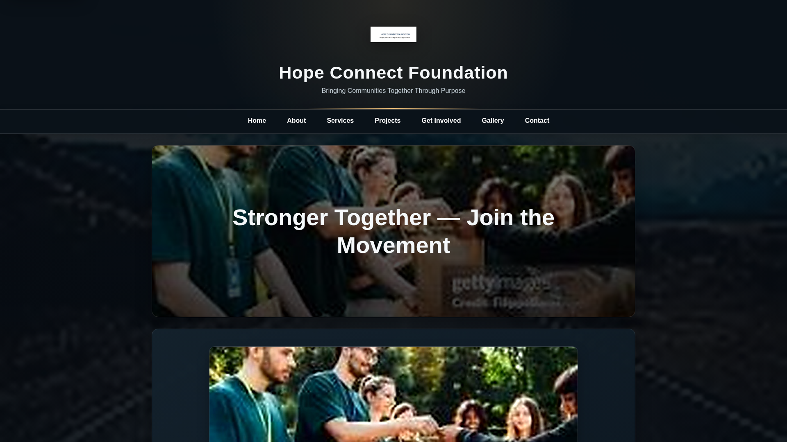
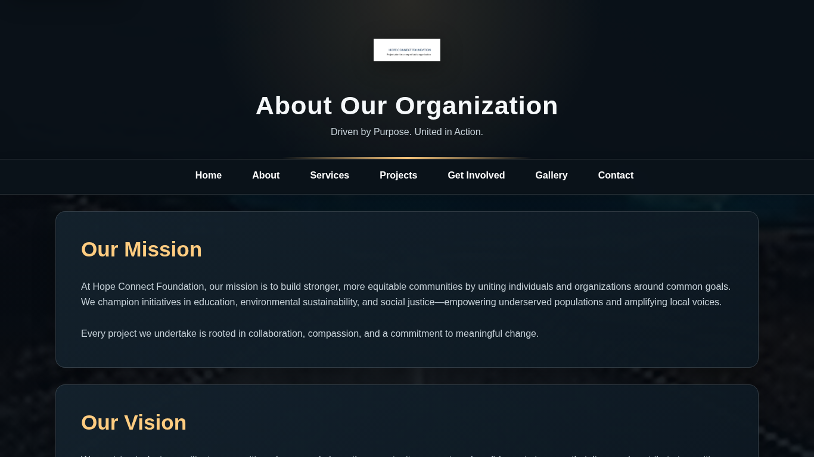
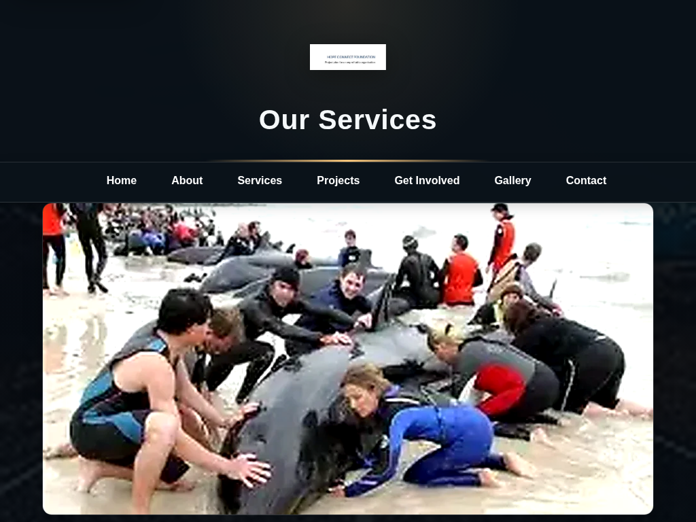
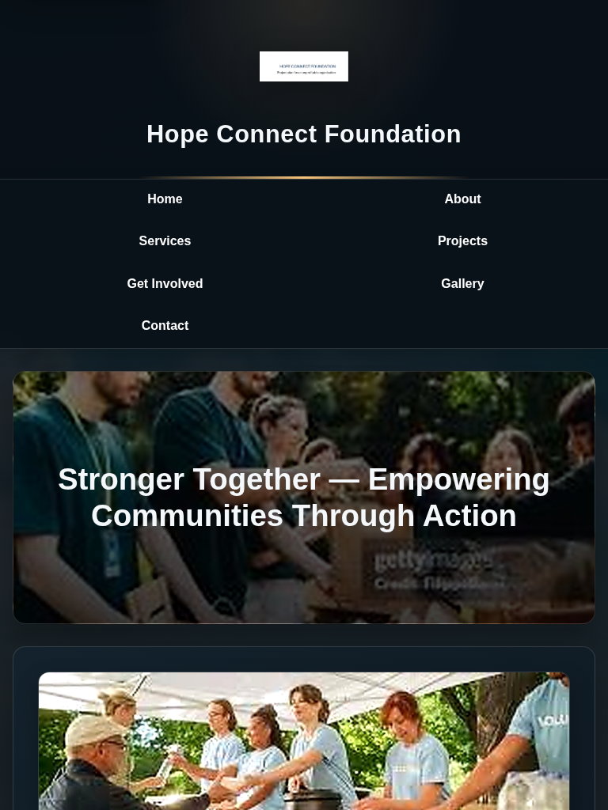
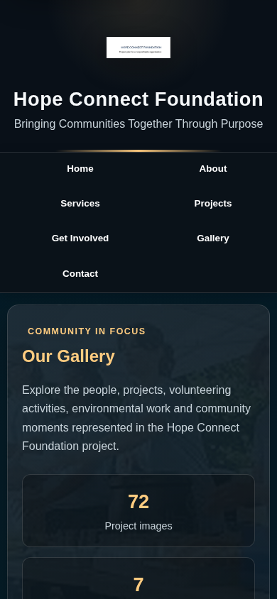
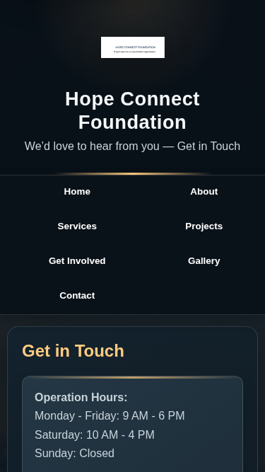

# Hope Connect Foundation - WEDE5020 Part 3

**Student:** Calvin Ramabusha  
**Student Number:** ST10502254  
**Module:** WEDE5020  
**Project:** Hope Connect Foundation Website  
**Repository:** https://github.com/ramabushac/st10502254wede5020  
<<<<<<< HEAD
**Live website:** https://ramabushac.github.io/st10502254wede5020/ *(update this link if the site is deployed elsewhere)*
=======
**Live website:** https://ramabushac.github.io/st10502254wede5020/ 
>>>>>>> 5e1bd94e84e505461bb43abfa16922a990e5192e

## Table of Contents

| No. | Section | Description |
|---|---|---|
| 1 | [Project Overview](#1-project-overview) | Purpose and Part 3 focus |
| 2 | [Website Pages](#2-website-pages) | Main website pages and support pages |
| 3 | [Project Structure](#3-project-structure) | Folders and files |
| 4 | [Dynamic Content, Search and Sorting](#4-dynamic-content-search-and-sorting) | JavaScript-loaded services and projects |
| 5 | [Forms, Validation and AJAX](#5-forms-validation-and-ajax) | Enquiry, contact and volunteer forms |
| 6 | [Search Engine Optimisation](#6-search-engine-optimisation-seo) | On-page, off-page and technical SEO |
| 7 | [Performance](#7-performance) | Page speed |
| 8 | [Security](#8-security-measures) | Security measures |
| 9 | [Accessibility](#9-accessibility) | Accessibility features |
| 10 | [Testing](#10-testing) | Automated and manual tests |
| 11 | [Deployment](#11-deployment) | Publishing the website |
| 12 | [Part 2 Feedback Response Log](#12-part-2-feedback-response-log) | Feedback and the changes made |
| 13 | [Changelog](#13-changelog) | Record of development |
| 14 | [Challenges and Decisions](#14-challenges-and-decisions) | Design decisions and limits |
<<<<<<< HEAD
| 15 | [Final Review Input](#15-final-review-input) | Final technical review and recommendations |
| 16 | [References](#16-references) | Harvard references |
=======
| 15 | [References](#15-references) | Harvard references |
>>>>>>> 5e1bd94e84e505461bb43abfa16922a990e5192e
| A | [Appendix: Part 2 Documentation](#appendix-part-2-documentation-retained) | Retained Part 2 notes and testing evidence |
| B | [Part 3 Review Improvements](#103-part-3-report-improvements-added) | Review/report changes and validation |

## 1. Project Overview

Hope Connect Foundation is a non-profit organisation website developed for the WEDE5020 module. Part 1 produced the structure and content, Part 2 added the external stylesheet, responsive design and accessibility, and **Part 3 adds interactivity, search engine optimisation and working forms**.

Part 3 delivers:

- **Dynamic content:** the Services and Projects pages are built by JavaScript from a data file, with live search, category filter and sorting.
- **Forms:** a new `enquiry.html` page and an upgraded `contact.html` form, plus the volunteer sign-up form, with HTML and JavaScript validation, friendly error messages and AJAX submission.
- **SEO:** unique titles and meta descriptions, one `h1` per page, descriptive image text, internal links, structured data, `robots.txt`, `sitemap.xml`, social sharing links and a keyword plan.
- **Documentation:** this README with a Part 2 feedback response log, a dated changelog and updated references.

## 2. Website Pages

| Page | File | Part 3 change |
|---|---|---|
| Home | `index.html` | Meta tags, structured data, one `h1` |
| About | `about.html` | Meta tags |
| Services | `services.html` | Dynamic, searchable, sortable list |
| Projects | `projects.html` | Dynamic, searchable, sortable list |
| Get Involved | `get-involved.html` | Volunteer form with validation and AJAX |
| Gallery | `gallery.html` | Descriptive alt text and captions, correct `sizes` |
| Enquiry | `enquiry.html` | **New page**: enquiry form with cost and availability response |
| Contact | `contact.html` | Upgraded form: phone, message type, validation, AJAX |
| Privacy Notice | `privacy.html` | New support page explaining form data, demo mode and privacy considerations |
| Error page | `404.html` | New recovery page for missing URLs; excluded from indexing |

The Enquiry link was added to the navigation of every main website page. Privacy Notice is available from the footer.

## 3. Project Structure

```text
st10502254wede5020/
├── index.html, about.html, services.html, projects.html
├── gallery.html, get-involved.html, contact.html
├── enquiry.html                 (new)
├── privacy.html                 (new)
├── 404.html                     (new)
├── favicon.svg                  (new)
├── robots.txt                   (new)
├── sitemap.xml                  (new)
├── _headers                     (new: security headers for Netlify)
├── README.md
├── PART3_REPORT_IMPROVEMENTS.md  (review/report improvement record)
├── css/
│   └── style.css                (Part 3 additions at the end)
├── js/
│   ├── script.js                (navigation, back-to-top, lightbox)
│   ├── data.js                  (new: services and projects data)
│   ├── dynamic.js               (new: render, search, filter, sort)
│   └── forms.js                 (new: validation, AJAX, email)
├── tests/
│   ├── unit.test.js             (new: logic tests, no installs needed)
<<<<<<< HEAD
│   └── e2e.test.js              (new: browser tests with Playwright)
=======
│   ├── e2e.test.js              (new: browser tests with Playwright)
│   └── static.test.js           (new: SEO, accessibility and link checks, no installs needed)
>>>>>>> 5e1bd94e84e505461bb43abfa16922a990e5192e
├── tools/
│   ├── rename_images.py         (new: was used to rename the images; kept for reference)
│   ├── set_site_url.py          (new: update the site address in one step)
│   └── GIT_COMMIT_PLAN.md       (new: suggested commit sequence)
├── images/
│   └── responsive/
└── wireframes/
```

## 4. Dynamic Content, Search and Sorting

**Requirement 2.2:** use JavaScript to load content dynamically and implement search to filter and sort content.

| Item | How it works |
|---|---|
| Data | `js/data.js` holds four services and five projects (title, category, icon, description, cost, availability). |
| Rendering | `js/dynamic.js` creates a card for each item with `createElement` and `textContent` (no `innerHTML`). |
| Search | A search box filters by every word typed across title, category and description, with a 150 ms delay while typing. |
| Filter | A category list is built from the data, so it stays correct when items are added. |
| Sort | Name A to Z, Name Z to A, or Category. |
| Feedback | A live count ("Showing 2 of 4 services") and a clear message when nothing matches. |
| Links | Each card links to `enquiry.html?type=...&item=...`, which pre-selects the enquiry type and fills the subject. |
| Without JavaScript | The original static list is kept inside `<noscript>`, so the content is still readable. |

To add a service or project, add one object to `js/data.js`. The cards, categories and counts update by themselves.

> The costs and availability in `js/data.js` are sample figures for this assignment. Replace them with the organisation's real details.

## 5. Forms, Validation and AJAX

### 5.1 Forms

| Form | Page | Fields |
|---|---|---|
| Enquiry | `enquiry.html` | Full name, email, phone, enquiry type (services, projects, volunteering, sponsorship, other), preferred date, subject, enquiry, consent |
| Contact | `contact.html` | Full name, email, phone (optional), message type, subject, message, consent |
| Volunteer | `get-involved.html` | Full name, email, volunteering activity |

All fields use the correct HTML elements: `input` (text, email, tel, date, checkbox), `select` and `textarea`, each with a `label`.

### 5.2 Validation rules

| Field | HTML validation | JavaScript validation and message |
|---|---|---|
| Full name | `required`, `minlength=2`, `maxlength=60` | Letters, spaces, hyphens and apostrophes only |
| Email | `type=email`, `required`, `maxlength=100` | Valid format, for example name@example.com |
| Phone | `type=tel`, `pattern`, `maxlength=16` | South African format such as 073 123 4567 or +27 73 123 4567 |
| Date | `type=date`, `min` = today | Format YYYY-MM-DD, real calendar date, not in the past |
| Subject | `required`, `minlength=5`, `maxlength=100` | Length message with the number of characters entered |
| Message | `required`, `minlength=20`, `maxlength=1000` | Length message and a live character counter |
| Type | `required` select | "Please choose an option" |
| Consent | `required` checkbox | Must be ticked |

**User-friendly errors:** each message appears beside the field it belongs to, the field gets a red outline, `aria-invalid` and `aria-describedby` are set for screen readers, the first invalid field receives focus, and a summary says how many fields need fixing. Messages disappear as soon as the problem is corrected.

### 5.3 AJAX submission

`js/forms.js` stops the normal submit, validates, builds the email and sends the data with `fetch` (JSON `POST`), so the page does not reload. A "Sending..." state prevents double submits, and a 10-second timeout prevents the form hanging.

- **Success:** a confirmation appears. On the enquiry form it also shows a **response about cost or availability** based on the chosen enquiry type and date (for example, Sunday dates explain that the organisation is closed).
- **Failure:** a friendly error appears, the details stay in the form, and a link offers to send the message from the visitor's own email app (`mailto:`).

### 5.4 Compiling the email

Each submission is compiled into an email with a subject and body (form, name, email, phone, type, date, subject, message and a timestamp). The recipient is set in one place in `js/forms.js`:

```js
var CONFIG = {
  recipient: "contact@hopeconnectfoundation.org",   // who receives the messages
  endpoint: "https://formspree.io/f/YOUR_FORM_ID",   // replace YOUR_FORM_ID
  ...
};
```

**Set-up (about five minutes):**

1. Create a free form at https://formspree.io and set its notification email to the recipient address.
2. Copy the form address into `CONFIG.endpoint` and put the same address in `CONFIG.recipient`.
3. Submit a test enquiry and confirm that the email arrives.

Until the endpoint is configured the forms run in **demo mode**: they validate, build the email and show it on screen, but nothing is delivered. The page says so clearly.

## 6. Search Engine Optimisation (SEO)

### 6.1 Keyword research

Keywords were chosen from the organisation's real focus areas and the phrases a volunteer or donor in South Africa would search for. Search volumes were **not** measured; validate and refine this list with Google Trends or Google Keyword Planner.

| Page | Primary keyword | Supporting keywords |
|---|---|---|
| Home | community outreach South Africa | volunteer opportunities, non-profit organisation |
| About | about Hope Connect Foundation | NGO mission, community volunteers |
| Services | community workshops | environmental consulting, fundraising assistance for NGOs |
| Projects | tree planting volunteers | youth mentorship programme, food drives South Africa |
| Get Involved | volunteer South Africa | volunteer sign up, community clean-up |
| Gallery | community clean-up photos | food drive photos, charity gallery |
| Contact | contact Hope Connect Foundation | charity contact South Africa |
| Enquiry | sponsor a charity | volunteer enquiry, services cost and availability |

### 6.2 On-page SEO

| Page | Title tag | Meta description length |
|---|---|---|
<<<<<<< HEAD
| index.html | Hope Connect Foundation \| Community Outreach in South Africa | 152 |
| about.html | About Us \| Hope Connect Foundation | 143 |
| services.html | Our Services \| Hope Connect Foundation | 146 |
| projects.html | Our Projects \| Hope Connect Foundation | 135 |
| get-involved.html | Get Involved \| Hope Connect Foundation | 149 |
| gallery.html | Gallery \| Hope Connect Foundation | 129 |
| contact.html | Contact Us \| Hope Connect Foundation | 134 |
| enquiry.html | Make an Enquiry \| Hope Connect Foundation | 147 |

- **Titles and descriptions:** every page has a unique title (under 70 characters) and a unique description under 160 characters containing its primary keyword.
- **Headings:** every page has exactly one `h1` (the site name in the header; the hero headings on Home and Projects were changed to `h2`), then `h2` sections and `h3` items in order.
- **Images:** all images have `alt` text. The 72 gallery images now have descriptive alt text and matching captions that describe what the picture shows (the earlier text was generated from file names). Generic file names such as `pic.jpg` and `hul.webp` were replaced with descriptive names (see 6.5).
- **URLs:** short, lowercase, hyphenated page names with no parameters (`services.html`, `get-involved.html`).
- **Internal linking:** every page links to every other page through the navigation, service and project cards link to the enquiry form, and the enquiry page links to Services, Projects, Get Involved and Contact.
- **Mobile-friendly:** viewport tag, responsive breakpoints and responsive images (Part 2), checked again at 375 px for the main interactive pages.
- **Open Graph and canonical tags** give search engines and social networks the right title, description and address for each page.
=======
| index.html | Hope Connect Foundation \| Community Outreach in South Africa | 154 |
| about.html | About Us \| Hope Connect Foundation | 146 |
| services.html | Our Services \| Hope Connect Foundation | 149 |
| projects.html | Our Projects \| Hope Connect Foundation | 134 |
| get-involved.html | Get Involved \| Hope Connect Foundation | 148 |
| gallery.html | Gallery \| Hope Connect Foundation | 131 |
| contact.html | Contact Us \| Hope Connect Foundation | 138 |
| enquiry.html | Make an Enquiry \| Hope Connect Foundation | 146 |

- **Titles and descriptions:** every page has a unique title (under 70 characters) and a unique description under 160 characters containing its primary keyword.
- **Headings:** every page has exactly one `h1` and it is unique to the page (About and Services keep their page title in the header; on the other pages the site name is now a styled paragraph and the page heading is the `h1`), then `h2` sections and `h3` items in order. Earlier versions repeated "Hope Connect Foundation" as the `h1` on six pages, which gives search engines no page-specific signal.
- **Images:** all images have `alt` text. The 72 gallery images now have descriptive alt text and matching captions that describe what the picture shows (the earlier text was generated from file names). Generic file names such as `pic.jpg` and `hul.webp` were replaced with descriptive names (see 6.5).
- **URLs:** short, lowercase, hyphenated page names with no parameters (`services.html`, `get-involved.html`).
- **Internal linking:** every page links to every other page through the navigation, service and project cards link to the enquiry form, and the enquiry page links to Services, Projects, Get Involved and Contact.
- **Mobile-friendly:** viewport tag, responsive breakpoints and responsive images (Part 2), checked again at 375 px for all eight pages.
- **Open Graph, Twitter Card and canonical tags** give search engines and social networks the right title, description, address and a preview image (`og:image`) for each page.
>>>>>>> 5e1bd94e84e505461bb43abfa16922a990e5192e
- **Structured data:** an `NGO` schema (JSON-LD) on the home page gives search engines the organisation name, address of the site, description and service area.

### 6.3 Off-page SEO

| Area | Plan |
|---|---|
| Backlinks | Ask partner organisations, schools, local business forums, volunteer-matching websites and local community pages to link to the site; list the site in non-profit directories; share project stories with local news and community blogs. |
| Social media | Every page has Share links for Facebook, WhatsApp, LinkedIn and X. Plan: post each project and volunteer day with a photo, a short story and a link to `enquiry.html` or `get-involved.html`. |
| Local SEO | Titles, descriptions, language (`en_ZA`) and the structured data target South Africa. Next steps: add the organisation's street address and a correct phone number to the Contact page, claim a Google Business Profile with identical name, address and phone details, and ask partners for local reviews. |

> Backlinks and social posts depend on actions outside the code. Record the real links and posts here once they exist.

### 6.4 Technical SEO files

- **`robots.txt`** allows all crawlers, blocks `/tools/` and `/wireframes/`, and points to the sitemap.
- **`sitemap.xml`** lists all eight pages with `lastmod`, `changefreq` and `priority`.
- Run `python tools/set_site_url.py https://your-site-address/` to update the canonical tags, sitemap and robots file when the final address is known.

> Search engines only read `robots.txt` at the root of a domain. A project page on GitHub Pages (`username.github.io/repository/`) is served below the root, so on GitHub Pages the file is present but ignored by crawlers. Deploying to Netlify, where the site is served from the root, avoids this.

### 6.5 Image file names

All 72 original images and their 192 resized copies in `images/responsive/` now have descriptive names, for example `hope-connect-volunteers-sorting-donated-goods-boxes-large.jpg`. The renaming was done with `tools/rename_images.py`, which also updated every reference in the HTML, CSS and README files; the script then confirmed that every referenced image exists. The script is kept for reference and runs as a dry run unless `--apply` is given.

## 7. Performance

| Improvement | Detail |
|---|---|
| Gallery `sizes` attribute | The gallery told the browser each thumbnail was up to 1200 px wide, so it chose the 1440 px copies. It now declares a quarter of the viewport on desktop. Estimated from file sizes, loading all 72 thumbnails dropped from about 19.6 MB (1440 px copies) to about 4.8 MB (480 px copies). |
| Lazy loading | All 72 gallery images use `loading="lazy"`, so only visible images are fetched first. |
| Responsive images | `srcset` with 480, 960 and 1440 px versions (Part 2). |
| Small scripts | The three new scripts total under 25 KB with no libraries or frameworks. |
<<<<<<< HEAD
| Next steps | Remove or compress the original full-size images (about 103 MB in `images/`), convert photos to WebP or AVIF, and add `loading="lazy"` to images lower down on other pages. |
=======
| Original image compression | 44 originals over 300 KB were limited to 2400 px on the long side and recompressed (about 50 MB down to 27 MB). The `images/` folder is about 39 MB, down from about 100 MB; the 480, 960 and 1440 px copies were not changed. |
| Next steps | Convert photos to WebP or AVIF, add `width` and `height` attributes to reduce layout shift (check the CSS first, because some images are sized by CSS), and add `loading="lazy"` to images lower down on other pages. |
>>>>>>> 5e1bd94e84e505461bb43abfa16922a990e5192e

## 8. Security Measures

- **Input validation** on the client (HTML and JavaScript) and **length limits** on every field. Client-side checks improve usability but can be bypassed, so the form service or server must validate again.
- **Output safety:** page content and visitor input are written with `textContent`, never `innerHTML`, which prevents script injection.
- **Spam protection:** a hidden honeypot field is ignored by people and silently rejects bots.
- **No secrets in the code:** only a public form endpoint is used; the recipient address is the only configuration.
- **Safe links:** external links use `rel="noopener noreferrer"`.
- **Security headers:** the `_headers` file sets `X-Content-Type-Options`, `X-Frame-Options`, `Referrer-Policy` and `Permissions-Policy` on Netlify. GitHub Pages ignores this file.
- **HTTPS:** provided automatically by GitHub Pages and Netlify.
<<<<<<< HEAD
- **Recommended next steps:** add a Content Security Policy and Subresource Integrity (`integrity` attribute) for the Font Awesome stylesheet.

## 9. Accessibility

New features follow the Part 2 approach: every control has a visible `label`; errors are announced with `role="alert"`, `aria-invalid` and `aria-describedby`; the status message is an `aria-live` region and receives focus; the search results count is announced politely; hover, `:focus-visible` and `:active` states are used on all new controls; and `prefers-reduced-motion` is respected.
=======
- **Content Security Policy:** `_headers` now sends a `Content-Security-Policy-Report-Only` header (scripts and styles from the site and cdnjs only, form posts to Formspree only, no framing). It is report-only because it has not been tested on a live Netlify deployment; check the browser console, then rename it to `Content-Security-Policy`. No page uses inline `style` attributes or inline scripts, so the policy should not need `unsafe-inline`.
- **Caching:** `_headers` also sets cache lifetimes for images, CSS and JavaScript on Netlify.
- **Recommended next step:** add Subresource Integrity (`integrity` attribute) for the Font Awesome stylesheet using the hash published by cdnjs.

## 9. Accessibility

New features follow the Part 2 approach: every control has a visible `label`; errors are announced with `role="alert"`, `aria-invalid` and `aria-describedby`; the status message is an `aria-live` region and receives focus; the search results count is announced politely; hover, `:focus-visible` and `:active` states are used on all new controls; decorative icons carry `aria-hidden="true"`; the gallery viewer moves focus to its close button when it opens, keeps Tab inside the viewer, locks page scrolling and returns focus to the thumbnail when it closes; and `prefers-reduced-motion` is respected.
>>>>>>> 5e1bd94e84e505461bb43abfa16922a990e5192e

## 10. Testing

### 10.1 Automated tests

<<<<<<< HEAD
| Suite | Command | Result (14 October 2026) |
|---|---|---|
| Unit tests: validation rules, email builder, cost and availability response, search, filter and sort | `node tests/unit.test.js` | 33 passed, 0 failed |
| Static site checks: metadata, accessibility, local references, sitemap coverage and documentation consistency | `node tests/static.test.js` | 761 passed, 0 failed, 2 warnings |
=======
| Suite | Command | Result (9 October 2026) |
|---|---|---|
| Unit tests: validation rules, email builder, cost and availability response, search, filter and sort | `node tests/unit.test.js` | 33 passed, 0 failed (re-run 14 October 2026) |
| Static site checks: 10 pages for lang, title and description length and uniqueness, one unique `h1`, alt text, unique ids, labels on every form control, local links and `srcset` files, sitemap coverage, Open Graph image | `node tests/static.test.js` | 880 passed, 0 failed, 2 warnings (14 October 2026) |
>>>>>>> 5e1bd94e84e505461bb43abfa16922a990e5192e
| Browser tests (Chromium via Playwright): dynamic cards, search and sort, empty and invalid forms, successful and failed AJAX submission, preselected enquiry type, honeypot, volunteer form, no horizontal scroll at 375 px on all pages, no JavaScript errors | `python -m http.server 8765` then `node tests/e2e.test.js` | **Not run in this environment: Playwright package is not installed** |

### 10.2 Manual test checklist

Complete this table with your own results before submission.

| Test | Chrome | Edge | Firefox | Phone | Tablet |
|---|---|---|---|---|---|
| Navigation and links | [ ] | [ ] | [ ] | [ ] | [ ] |
| Services search, filter and sort | [ ] | [ ] | [ ] | [ ] | [ ] |
| Projects search, filter and sort | [ ] | [ ] | [ ] | [ ] | [ ] |
| Enquiry form: errors, success, response | [ ] | [ ] | [ ] | [ ] | [ ] |
| Contact form: errors, success | [ ] | [ ] | [ ] | [ ] | [ ] |
| Volunteer form | [ ] | [ ] | [ ] | [ ] | [ ] |
| Live site loads, images show, forms deliver email | [ ] | [ ] | [ ] | [ ] | [ ] |

## 10.3 Part 3 Report Improvements Added

The external review/report was used as a final quality check rather than as a reason to rebuild the site. The most useful low-risk improvements have been added:

- **Privacy notice:** `privacy.html` explains the information requested by the forms, demo-mode limitations, security measures and the need for a fuller POPIA-aligned notice before real-world use.
- **Custom 404 page:** `404.html` gives visitors a clear recovery path instead of a blank or generic missing-page response.
- **Favicon:** `favicon.svg` gives the site a consistent browser-tab identity.
- **Loading feedback:** Services and Projects now show a short loading message and use `aria-busy` while JavaScript renders the dynamic cards.
- **Footer utility links:** the main pages now provide direct access to the Privacy Notice and Contact page.
- **SEO:** the Privacy Notice is included in `sitemap.xml`; the 404 page is intentionally excluded from indexing.
- **Image/content review note:** the project still contains supplied/sample images and some duplicated files. Their licensing/permission should be confirmed before a real public launch; no unsupported licence claim has been added to the README.

Items that require a real deployment or external service, such as Lighthouse scores, live form delivery and verified image licences, are **not claimed as completed** until they are actually tested or confirmed.

## 11. Deployment

**GitHub Pages:** repository Settings, Pages, Source: Deploy from a branch, branch `main`, folder `/ (root)`. The site address will be `https://<username>.github.io/<repository>/`.

**Netlify:** add a new site from the GitHub repository (no build command, publish directory is the project folder). Netlify serves the site from the root, so `robots.txt` and `sitemap.xml` work as intended and the `_headers` file applies.

After deploying: open every page on the live address, submit each form, check that images load, then update the **Live website** link at the top of this README and run `tools/set_site_url.py` with the final address.

## 12. Part 2 Feedback Response Log

The Part 2 rubric scored the submission 87/100. Marks were lost in three documentation criteria, and each is addressed below.

| Feedback (Part 2 rubric) | Score | Action taken in Part 3 | Evidence |
|---|---|---|---|
| Feedback for Part 1: changes based on feedback need more detail and a fuller changelog | 3 / 10 | Added this feedback response log, which lists each piece of feedback, the change made and where to find it. | Section 12 |
| GitHub: changelog section contains a record of development | 0 / 5 | Added a dedicated Changelog with version numbers, dates, categories (Added, Changed, Fixed) and the real commit messages from the Git history. | Section 13 |
| GitHub: README contains all relevant information | 4 / 5 | Restructured the README with a table of contents, set-up steps, validation rules, SEO plan, performance, security, testing, deployment and updated references. | Whole README |
| Strong areas to keep: external stylesheet, default styles, typography, layout, decoration and colour, pseudo-classes, media queries, layout, typography, navigation and image adjustments, commits and references (full marks) | 10 / 10 each | New styles reuse the existing colour variables and tokens; new controls have hover, focus-visible and active states; new breakpoints at 800 px and 520 px; commits remain small and descriptive; new references use the same Harvard format. | `css/style.css`, section 15 |

<<<<<<< HEAD
**Part 1 feedback:** the Part 2 README recorded the changes made after Part 1 but did not quote the feedback itself.

> TODO (student): paste the Part 1 lecturer feedback below, one line each, and write what you changed for it. Example: *Feedback: "Alt text is too short." Change: rewrote alt text on all images (see Changelog 3.0.0).*
=======
**Part 1 feedback: the Part 2 README recorded the improvements made after Part 1 but did not preserve the original lecturer comments verbatim.

The available evidence for Part 1 feedback was the Part 2 rubric and assessment outcome. Consequently, the improvements documented in this project are based on the rubric criteria, lecturer scoring, and the areas identified for improvement in Part 2. No additional written Part 1 feedback was available at the time of preparing this Part 3 submission.

The changes implemented in response to the identified areas for improvement include:

• Addition of a detailed feedback response log.
• Introduction of a comprehensive project changelog.
• Expansion of the README to include setup, testing, deployment, SEO, accessibility, security and validation documentation.
• Improved evidence of responsive testing and project verification.
• Additional technical documentation and project audit records.

These changes were implemented to address the documentation-related weaknesses identified in the Part 2 assessment and to provide a more complete record of the project's development process.*
>>>>>>> 5e1bd94e84e505461bb43abfa16922a990e5192e

## 13. Changelog

All notable changes to this project are recorded here, newest first. The format follows Keep a Changelog, and the commit messages are taken from the Git history of this repository.

<<<<<<< HEAD
### [3.2.0] - 2026-10-14 (Final technical review input)

**Added**
- `tests/static.test.js`: dependency-free static checks covering metadata, accessibility, local references, sitemap coverage and documentation consistency.
- `FINAL_REVIEW_AND_RECOMMENDATIONS.md`: final review findings and the remaining manual submission checks.
- Open Graph image, image alt text and Twitter image metadata on the indexable pages.

**Changed**
- Standardised Font Awesome to version 6.5.2 across all HTML pages.
- Corrected README and sitemap documentation to distinguish the nine indexable pages from `404.html`.
- Recorded the static test result: 761 passed, 0 failed, 2 warnings.

**Still requires student verification**
- Formspree live endpoint and actual email delivery.
- Image licensing/permission for supplied images.
- Lighthouse results on the deployed website.
- Playwright browser results if required by the rubric.
=======
### [3.2.0] - 2026-10-14 (Part 3 analysis and improvements)

**Added**
- `tests/static.test.js`: 880 automated checks across all pages. Run against the previous version it reported 23 failures; it now reports 0 failures and 2 warnings.
- `og:image`, `og:image:alt` and `twitter:image` tags with a `summary_large_image` card on every indexable page.
- Gallery viewer focus management: focus moves into the viewer, Tab is kept inside it, page scroll is locked and focus returns to the thumbnail on close.
- `Content-Security-Policy-Report-Only` and cache headers in `_headers`.
- `REVIEW_PART3_ANALYSIS.md`: findings, fixes and the items still open.

**Changed**
- Each page now has its own unique `h1` (six pages previously repeated "Hope Connect Foundation").
- `lang="en-ZA"` on every page; one Font Awesome version (6.5.2) on every page; decorative icons hidden from screen readers.
- 44 original images recompressed (about 50 MB down to 27 MB); `sitemap.xml` dates refreshed; README meta description lengths corrected to match the pages.

**Removed**
- Unused form-handling branch in `js/script.js` (all three forms are handled by `js/forms.js`).
>>>>>>> 5e1bd94e84e505461bb43abfa16922a990e5192e

### [3.1.0] - 2026-10-14 (Part 3 review improvements)

**Added**
- `privacy.html` with a plain-language privacy notice and a clear explanation of the current demo-mode form limitation.
- `404.html` with a recovery link back to the website.
- `favicon.svg` for browser-tab identity.
- Loading feedback and `aria-busy` state for dynamically rendered Services and Projects content.
- Footer links to the Privacy Notice and Contact page.

**Changed**
- Added the Privacy Notice to `sitemap.xml`.
- Updated this README to separate completed improvements from items that still require live deployment, external service configuration or licence confirmation.
- Confirmed the automated unit suite locally: 33 passed, 0 failed.
- Attempted the Playwright browser suite, but it could not run because the Playwright package is not installed in the current environment; no browser-test score is claimed.

### [3.0.0] - 2026-10-09 (Part 3)

**Added**
- `enquiry.html` with a validated enquiry form that shows a cost or availability response.
- `js/data.js` and `js/dynamic.js`: Services and Projects built dynamically, with search, category filter and sorting.
- `js/forms.js`: validation with friendly messages, AJAX submission with `fetch`, email compilation, timeout and `mailto:` fallback.
- Contact form fields for phone number and message type; consent checkboxes; honeypot spam field.
- `robots.txt`, `sitemap.xml`, `_headers`, canonical, Open Graph and Twitter tags, JSON-LD structured data.
- Share links (Facebook, WhatsApp, LinkedIn, X) in every footer.
- Unit and browser tests in `tests/`; `tools/rename_images.py`, `tools/set_site_url.py` and `tools/GIT_COMMIT_PLAN.md`.
- Descriptive file names for all 72 images and their 192 resized copies.

**Changed**
- Unique title and meta description on all eight pages; Enquiry link added to every navigation menu.
- Home and Projects hero headings changed from `h1` to `h2` so each page has one `h1`.
- Volunteer sign-up form now uses the same validation and AJAX submission.
- Gallery `sizes` attribute corrected so the browser loads smaller image copies.
- `script.js` no longer handles forms managed by `forms.js`.
- README rebuilt for Part 3, with the Part 2 notes kept in the appendix.

**Fixed**
- Gallery alt text and captions were generated from file names (for example "Alexander Simonsen 44Al1Glfvxo Unsplash"); they now describe each picture.
- Added the missing meta descriptions on all seven original pages.
- Added the missing changelog and feedback response log (see section 12).
- The lightbox image in `gallery.html` had an empty `src` attribute, which makes some browsers request the page twice; it now uses a tiny placeholder image.

### [2.1.0] - 2026-09-18 (Part 2 finalisation)

- Rename website screenshots
- Add Part 2 audit, accessibility fixes and assets
- Add device screenshots
- Add testing screenshots; update README
- Move testing screenshots and clean up docs
- Rename validation doc
- Refine audit document title
- Rename browser testing image assets
- Create desktop-home-1920x1080.png
- Move testing screenshots and update docs
- Finalize Part 2 README and validation docs
- Finalize submission docs and screenshots

### [2.0.0] - 2026-09-09 to 2026-09-17 (Part 2 development)

- 2026-09-09: Improvement; improved project; Update review and add wireframes
- 2026-09-11: Enhance gallery and responsive styling
- 2026-09-12: Add enhancement layer, wireframes and optimized images
- 2026-09-13: Enhance site accessibility and responsive layout
- 2026-09-17: Add responsive assets and final cleanup

### [1.1.0] - 2026-08-14 to 2026-08-28 (Part 1 refinements)

- 2026-08-14: coment; picture
- 2026-08-28: Add nav stylesheet and link

### [1.0.0] - 2026-08-13 (Part 1)

- Initial commit

## 14. Challenges and Decisions

- **Static hosting has no server.** A static site cannot send email by itself, so the forms post to a form service (Formspree) and keep a `mailto:` fallback. The recipient is set in one place.
- **Demo mode.** Until the endpoint is configured the forms do not deliver anything and say so, rather than pretending to send.
- **Data in JavaScript.** Keeping services and projects in `data.js` makes the cards, categories and counts update automatically, with a `<noscript>` fallback.
- **Image descriptions.** Earlier alt text came from file names. Writing real descriptions for 72 images took the most time and gives the biggest accessibility and SEO gain.
- **Image quality check.** Some gallery images should be reviewed before final submission: one stock photo carries a visible agency watermark, one image is a UK health-campaign poster, one is a personal photo, and several images are duplicated. Confirm that each has a licence or permission, and remove or replace those that do not.
- **Sample content.** Prices, availability and sponsorship amounts are sample figures and must be replaced with real information.

<<<<<<< HEAD
## 15. Final Review Input

A final technical review was completed against the supplied Part 3 assessment/report and the project files. The review kept the strongest existing work and added low-risk improvements rather than changing the project unnecessarily.

Key review decisions:

- Keep the dynamic Services and Projects features, search, filtering, sorting and enquiry links because they directly demonstrate Part 3 JavaScript requirements.
- Keep the validation, AJAX structure, honeypot and mailto fallback, but clearly label the current Formspree endpoint as demo mode until a real endpoint is configured and tested.
- Keep the privacy notice and custom 404 page because they improve completeness and user experience without changing the main design.
- Standardise Font Awesome to version 6.5.2 across the HTML pages so the documentation and implementation agree.
- Add a dependency-free static test suite so the README claim about automated static checks is supported by an actual file in the submission.
- Keep Lighthouse, live form delivery, image licensing and Playwright browser results as outstanding verification items rather than inventing results.
- Preserve the `.git` repository in the full project copy so the lecturer can inspect the development history.

The remaining manual checks should be completed by the student on the actual deployed site before submission, especially browser/device testing, live form delivery if required, and confirmation that all images are permitted for use.

## 16. References
=======
## 15. References
>>>>>>> 5e1bd94e84e505461bb43abfa16922a990e5192e

Google. (n.d.) *SEO Starter Guide*. Available at: https://developers.google.com/search/docs/fundamentals/seo-starter-guide (Accessed: 9 October 2026).

Google. (n.d.) *Introduction to robots.txt*. Available at: https://developers.google.com/search/docs/crawling-indexing/robots/intro (Accessed: 9 October 2026).

Mozilla Developer Network (MDN) Web Docs. (n.d.) *Client-side form validation: Constraint validation*. Available at: https://developer.mozilla.org/en-US/docs/Web/HTML/Guides/Constraint_validation (Accessed: 9 October 2026).

Mozilla Developer Network (MDN) Web Docs. (n.d.) *Using the Fetch API*. Available at: https://developer.mozilla.org/en-US/docs/Web/API/Fetch_API/Using_Fetch (Accessed: 9 October 2026).

OWASP Foundation. (n.d.) *Cross Site Scripting Prevention Cheat Sheet*. Available at: https://cheatsheetseries.owasp.org/cheatsheets/Cross_Site_Scripting_Prevention_Cheat_Sheet.html (Accessed: 9 October 2026).

Sitemaps.org. (n.d.) *Sitemaps XML format*. Available at: https://www.sitemaps.org/protocol.html (Accessed: 9 October 2026).

Mozilla Developer Network (MDN) Web Docs. (n.d.) *CSS Grid Layout*. Available at: https://developer.mozilla.org/en-US/docs/Web/CSS/CSS_grid_layout (Accessed: 18 September 2026).

Mozilla Developer Network (MDN) Web Docs. (n.d.) *CSS Flexible Box Layout*. Available at: https://developer.mozilla.org/en-US/docs/Web/CSS/CSS_flexible_box_layout (Accessed: 18 September 2026).

Mozilla Developer Network (MDN) Web Docs. (n.d.) *Responsive images*. Available at: https://developer.mozilla.org/en-US/docs/Learn_web_development/Core/Performance/Responsive_images (Accessed: 18 September 2026).

World Wide Web Consortium (W3C). (n.d.) *CSS Snapshot*. Available at: https://www.w3.org/TR/css/ (Accessed: 18 September 2026).

World Wide Web Consortium (W3C). (2023) *Web Content Accessibility Guidelines (WCAG) 2.2*. Available at: https://www.w3.org/TR/WCAG22/ (Accessed: 18 September 2026).

## Appendix: Part 2 Documentation (retained)

The sections below are the Part 2 documentation, kept so the earlier testing evidence and screenshots stay linked.

### A1. External CSS Stylesheet

All seven website pages use the shared external stylesheet:

`css/style.css`

The stylesheet provides:

- CSS reset and base styling
- Consistent colour variables
- Font family, font size, font weight, line height and letter spacing
- Consistent margins, padding and spacing
- Flexbox layouts for navigation and content sections
- CSS Grid layouts for cards, projects and galleries
- Borders, shadows, gradients and other visual styling
- `:hover`, `:focus-visible` and `:active` states
- Responsive breakpoints and relative units
- Responsive typography using `clamp()`
- Reduced-motion support
- Print-friendly styling

### A2. Typography

Typography was styled using CSS properties including:

- `font-family`
- `font-size`
- `font-weight`
- `line-height`
- `letter-spacing`

Relative units such as `rem`, `em`, `%`, `vw` and `vh` are used for responsive sizing and spacing. `clamp()` is used where appropriate to allow text and spacing to scale between screen sizes.

### A3. Layout Design

The website uses both Flexbox and CSS Grid to create flexible desktop and responsive layouts.

**Flexbox** is used for areas such as:

- Main navigation
- Navigation controls
- Content alignment
- Flexible component layouts

**CSS Grid** is used for areas such as:

- Project cards
- Service cards
- Gallery layouts
- Multi-column content sections

Larger layouts reduce to fewer columns or a single column on smaller screens to improve readability and usability.

### A4. Visual Styling and Interaction

The visual design uses:

- Consistent colours and backgrounds
- Borders and rounded elements
- Box shadows
- Gradients
- Responsive spacing
- Hover effects
- Focus indicators
- Active states
- Transitions

These styles provide visual hierarchy and clear feedback when users interact with navigation links, buttons, forms and gallery elements.

### A5. Responsive Design

The website was designed to respond to desktop, tablet and mobile screen sizes.

#### Breakpoints

| Device | Breakpoint |
|---|---|
| Mobile | Up to 767px |
| Tablet | 768px to 1023px |
| Desktop | 1024px and above |

Additional adjustments are used at smaller intermediate widths where required to improve navigation, typography, spacing and content layout.

Responsive design includes:

- Flexible widths using `%`
- Responsive spacing using `rem` and `em`
- Responsive viewport units such as `vw` and `vh`
- `clamp()` for scalable typography and spacing
- Multi-column layouts on larger screens
- Single-column layouts on smaller screens
- Responsive navigation
- Mobile-friendly cards, forms and gallery layouts
- Prevention of unnecessary horizontal scrolling

### A6. Responsive Images

Responsive image techniques were added using `srcset` and `sizes` attributes. Resized image variants are stored in:

`images/responsive/`

The browser is able to select a suitable image resource based on the available display size and device resolution. This improves responsive presentation and avoids loading a larger image than necessary where an appropriate alternative is available.

### A7. Accessibility and Usability

Accessibility and usability were considered throughout the website. Features include:

- Descriptive `alt` text for images
- Skip-to-main-content links
- Visible keyboard focus indicators
- `:focus-visible` styling
- Accessible form controls and labels
- Clear navigation states
- Mobile-friendly touch targets
- Reduced-motion support
- Responsive layouts for different devices

### A8. Browser Developer Tools Testing

The website was tested using browser Developer Tools with device emulation enabled. Testing confirms that the website remains usable and visually consistent at different viewport sizes.

#### Required Test Viewports

| Device category | Viewport | Page used for evidence |
|---|---:|---|
| Desktop | 1920 × 1080 | Home |
| Desktop | 1366 × 768 | About |
| Tablet | 1024 × 768 | Services |
| Tablet | 768 × 1024 | Projects |
| Mobile | 390 × 844 | Gallery |
| Mobile | 375 × 667 | Contact |

During testing, the following were checked:

- Navigation and menu behaviour
- Text readability and wrapping
- Image responsiveness
- Card layouts
- Form usability
- Gallery behaviour
- Interactive elements
- Horizontal overflow
- Spacing and alignment
- Breakpoint transitions

### A9. Screenshot Evidence

The responsive testing screenshots are stored together in the main `images/` folder. They are linked directly below using relative paths so that they display when the README is viewed in the project repository or directly from the extracted project folder.

#### Desktop Testing

**Figure 1: Home page tested at 1920 × 1080.**



**Figure 2: About page tested at 1366 × 768.**



#### Tablet Testing

**Figure 3: Services page tested at 1024 × 768.**



**Figure 4: Projects page tested at 768 × 1024.**



#### Mobile Testing

**Figure 5: Gallery page tested at 390 × 844.**



**Figure 6: Contact page tested at 375 × 667.**



#### Testing Checks

The responsive testing covered:

- Navigation and menu behaviour
- Text readability and wrapping
- Responsive image presentation
- Card and grid layouts
- Form usability
- Gallery layout and controls
- Interactive elements
- Horizontal overflow
- Spacing and alignment
- Breakpoint changes between desktop, tablet and mobile layouts

---

**WEDE5020 Part 3 - Hope Connect Foundation**  
**Student Number: ST10502254**
